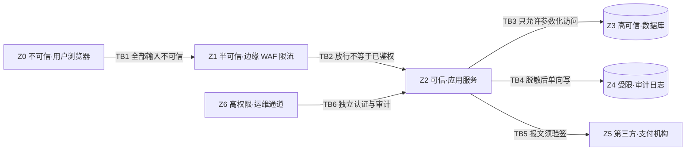
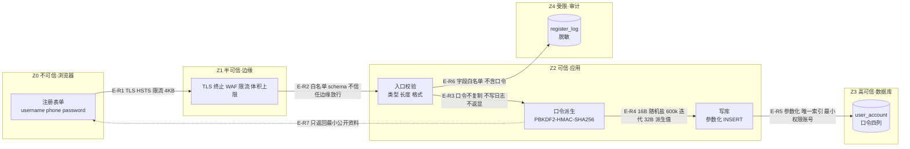
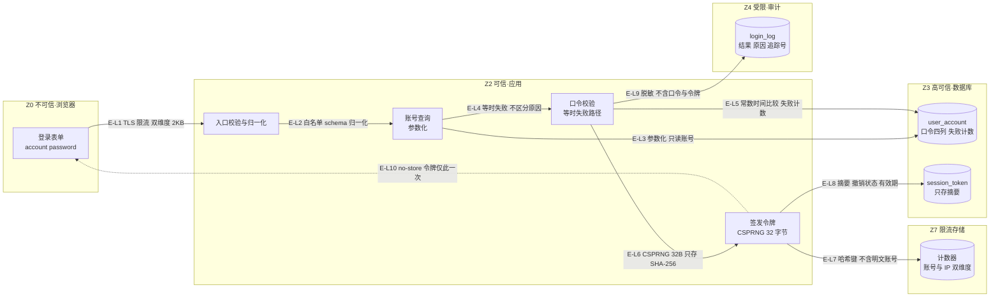
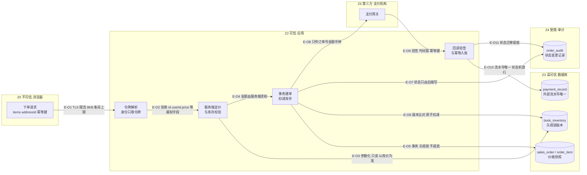

# 数据流与信任边界

| 项目 | 内容 |
| :--- | :--- |
| 文档编号 | DES-01 |
| 覆盖流程 | 注册、登录、下单 |
| 上游基线 | [`API草案V1.md`](../requirements/week04/API草案V1.md)、[`数据字典V1.md`](../requirements/week04/数据字典V1.md)、[`ROLE_PERMISSIONS.md`](../roles/ROLE_PERMISSIONS.md)（基线提交 `9bfcc16f`） |
| 下游材料 | [`02-安全需求.md`](./02-安全需求.md)、[`03-接口契约.md`](./03-接口契约.md)、[`04-控制指认与整改输入.md`](./04-控制指认与整改输入.md) |
| 阶段归属 | 第 6-9 周·阶段一（威胁建模与安全设计） |
| 状态 | V1，交第 6-9 周验收 |

## 1. 范围与本设计的边界

本文只做**安全设计**：把注册、登录、下单三条流程的数据流画清楚，标出信任边界，并在每条跨边界连线上注明需要什么控制。控制落到哪条安全需求，见 [`02-安全需求.md`](./02-安全需求.md)；控制的实现位置或整改编号，见 [`04-控制指认与整改输入.md`](./04-控制指认与整改输入.md)。

明确不做的事：

1. **不做渗透测试**：本文只声明控制要求与可验证的通过判据，不给出攻击执行结果。
2. **不写业务代码**：`db/schema.sql` 与 `src/user/` 归阶段二的数据地基与用户模块负责人；本文只提出字段与约束需求。
3. **不重做密码学线**：口令派生直接复用第 5 周 `src/crypto/加盐哈希.py` 的 `hash_password` / `verify_password`，不新写算法。
4. **不改第 4 周已冻结的接口边界**：本文在 `API草案V1` 的既有路径上补齐安全约束；下单接口在 V1 中属 P2 预留，本文只定安全契约与字段需求，不实现。

## 2. 受保护资产

任务书要求覆盖三类资产，另有一类被牵连资产一并登记，因为它常是前两类被破坏后的二次泄露点。

| 资产编号 | 资产 | 具体内容 | 被破坏的后果 | 主要流经流程 |
| :--- | :--- | :--- | :--- | :--- |
| AS-01 | 用户凭证 | 登录名、手机号、口令原文、口令派生值、盐、迭代次数 | 攻击者可登录任意已还原口令的账号；同一口令在其他站点的账号连带失守 | 注册、登录 |
| AS-02 | 会话令牌 | 服务端签发的访问令牌、库中令牌摘要、撤销状态、有效期 | 攻击者可直接以受害者身份调用全部受保护接口，且无需知道口令 | 登录、退出、下单、订单查询 |
| AS-03 | 订单与支付 | 订单号、订单明细、单价与总价、库存占用、支付状态、支付回调报文 | 攻击者少付或不付即可成交、超卖、重复入账；商家与买家对账失衡 | 下单、支付回调 |
| AS-04 | 个人信息（牵连） | 手机号、收货地址、联系人 | 订单被越权读取时一并泄露，构成二次伤害 | 注册、下单、订单查询 |

资产与数据字典的敏感级对应关系：AS-01 → S3；AS-02 → S3；AS-03 → S1（金额与状态）+ S2（收货信息）；AS-04 → S2。敏感级定义见 `数据字典V1.md` §2.3。

## 3. 信任域与信任边界

### 3.1 信任域

| 域 | 名称 | 信任假设 | 可访问的数据 | 说明 |
| :--- | :--- | :--- | :--- | :--- |
| Z0 | 用户浏览器 | **不可信**。代码与运行环境均由用户控制，任何前端校验只作体验优化 | 仅用户本人在界面可见的数据 | 攻击者可完整读取、篡改、重放此域内的一切 |
| Z1 | 边缘层（TLS 终止、WAF、限流） | 半可信。只做协议与流量层判断，不做业务鉴权 | 请求头、请求体（明文，TLS 已终止） | 一旦被绕过，Z2 必须仍能独立拒绝 |
| Z2 | 应用服务 | 可信。唯一持有数据库凭据与令牌签发能力的域 | 全部业务数据（按最小权限分服务账号） | 鉴权、归属校验、金额与库存权威计算都在此域 |
| Z3 | 数据库 | 高可信，但**只允许 Z2 连接** | 全部持久化数据 | 口令四列、令牌摘要、订单与库存的最终事实来源 |
| Z4 | 审计与日志存储 | 受限，**单向写入** | 脱敏后的操作记录 | Z2 只能写，不能改不能删；不接收口令、令牌、派生值 |
| Z5 | 支付机构（第三方） | 按契约可信。其报文必须验签后才可作为事实 | 仅订单号、金额、币种、支付状态 | 不得直连 Z3；不得接触 AS-01 / AS-02 |
| Z6 | 运维与管理通道 | 高权限，独立边界 | 按授权范围 | 与业务流量分离，单独认证，操作留审计 |

### 3.2 信任边界清单

| 边界 | 位置 | 两侧 | 越界即意味着 |
| :--- | :--- | :--- | :--- |
| TB1 | 互联网接入点 | Z0 ↔ Z1 | 任何来自浏览器的输入都可能是构造的 |
| TB2 | 边缘到应用 | Z1 ↔ Z2 | Z1 的放行结论**不可作为** Z2 的鉴权依据 |
| TB3 | 应用与数据库 | Z2 ↔ Z3 | 一旦 Z2 拼接查询，Z3 的完整性即失守 |
| TB4 | 应用与审计 | Z2 ↔ Z4 | 日志是独立的泄露面，必须脱敏后单向写入 |
| TB5 | 与支付机构 | Z2 ↔ Z5 | 回调报文默认不可信，必须先验签再采信 |
| TB6 | 运维与管理 | Z6 ↔ Z2 / Z3 | 高权限操作需独立认证、二次确认与审计 |

### 3.3 总览

## 4. 注册流程

### 4.1 参与者与前置

- 参与者：未注册访客（Z0）、应用服务（Z2）。
- 前置：系统已具备可用 TLS 证书；口令派生函数可用（`src/crypto/加盐哈希.py`）。
- 出口：`user_account` 新增一行，口令以四列形式落库；返回最小公开资料。

### 4.2 数据流图

### 4.3 步骤与数据载体

| 步骤 | 执行位置 | 输入数据 | 输出数据 | 数据形态 | 对应连线 |
| :--- | :--- | :--- | :--- | :--- | :--- |
| S1 | Z0 | 用户填写的 `username`、`phone`、`password` | 同左，JSON 请求体 | 明文，仅在 TLS 通道内 | E-R1 |
| S2 | Z1 | 请求体 | 放行或拦截 | 明文，TLS 已终止 | E-R1、E-R2 |
| S3 | Z2 | 请求体 | 归一化后的字段 + 校验结论 | 内存中的字符串 | E-R2 |
| S4 | Z2 | 归一化口令 | `password_algo`、`password_iterations`、`password_salt`、`password_derived` | 算法标识字符串 + 整数 + 16 字节盐 + 32 字节派生值 | E-R3、E-R4 |
| S5 | Z2 → Z3 | 上述四列 + 用户名 + 手机号指纹 | 新增行主键 | 参数化写入 | E-R5 |
| S6 | Z2 → Z4 | 结果、`trace_id`、脱敏账号 | 审计记录 | 脱敏文本 | E-R6 |
| S7 | Z2 → Z0 | 用户主键、用户名、脱敏手机号、状态、创建时间 | `201` 响应体 | JSON | E-R7 |

**关键点：口令原文的生命周期止于 S4。** S4 之后内存里只应保留派生值与盐；响应组装阶段不得回读口令字段。这不是靠"记得删"来保证，而是靠 DTO 白名单序列化来保证——响应对象从类型上就没有口令字段。

### 4.4 跨边界连线与控制

| 连线 | 跨越 | 方向 | 承载数据 | 需要的控制 | 对应安全需求 |
| :--- | :--- | :--- | :--- | :--- | :--- |
| E-R1 | TB1 | Z0 → Z1 | 含明文口令的请求体 | TLS 1.2+ 且禁用弱套件；HSTS；请求体上限 4 KB；强制 `Content-Type: application/json`；按 IP 与设备维度限流；慢速攻击防护 | SR-03、SR-20 |
| E-R2 | TB2 | Z1 → Z2 | 同上 | **不采信边缘的放行结论**；Z2 独立做 schema 白名单校验（`additionalProperties: false`）；只允许边缘网段访问应用端口 | SR-12、SR-19 |
| E-R3 | Z2 内部 | 校验 → 派生 | 归一化口令 | 口令不写入任何日志、异常、监控标签；派生调用参数由服务端常量决定，不接受请求传入迭代次数或盐 | SR-02、SR-03 |
| E-R4 | Z2 内部 | 派生 → 写库 | 四列口令 | 盐必须来自密码学安全随机源且每账号唯一；迭代次数取服务端基线值；派生值长度 32 字节；比较用常数时间函数 | SR-01、SR-02 |
| E-R5 | TB3 | Z2 → Z3 | 用户行 + 四列口令 | 全程参数化语句，SQL 文本不含任何用户输入拼接；应用账号仅授予该表的 `INSERT` 与必要 `SELECT`；唯一索引兜底并发重复注册 | SR-01、SR-19 |
| E-R6 | TB4 | Z2 → Z4 | 注册结果、追踪编号 | 只写白名单字段；不写口令、派生值、盐；账号以脱敏形式记录；审计库对应用账号只开写权限 | SR-03、SR-19 |
| E-R7 | TB1 | Z2 → Z0 | 最小公开资料 | 响应对象为专用 DTO，字段白名单；`Cache-Control: no-store`；响应中不出现任何口令相关列 | SR-01、SR-11 |

### 4.5 本流程的失败路径

| 情况 | 对外结果 | 内部处理 | 注意 |
| :--- | :--- | :--- | :--- |
| 字段缺失、类型错、超长、格式不符 | `400 VALIDATION_ERROR`，`details` 只指出请求字段名与原因枚举 | 记审计（脱敏） | 不得回显用户提交的原值，避免把恶意串带到日志与页面 |
| 登录名或手机号已存在 | `409 USER_ALREADY_EXISTS` | 记审计 | 该响应**必然暴露"此手机号已注册"**。这是注册功能的固有代价，不通过改文案掩盖，改用限流压低探测速率（见 SR-20） |
| 派生或写库异常 | `500 INTERNAL_ERROR` + `traceId` | 完整异常只进受限日志，不进响应 | 响应体不得出现表名、列名、SQL、堆栈 |

## 5. 登录流程

### 5.1 参与者与前置

- 参与者：已注册用户（Z0）、应用服务（Z2）。
- 前置：账号 `status = active`；口令四列可读。
- 出口：服务端签发访问令牌，库中只留摘要；签发动作写审计。

### 5.2 数据流图

### 5.3 步骤与数据载体

| 步骤 | 执行位置 | 输入数据 | 输出数据 | 数据形态 | 对应连线 |
| :--- | :--- | :--- | :--- | :--- | :--- |
| S1 | Z0 | `account`、`password` | 请求体 | 明文，仅在 TLS 通道内 | E-L1 |
| S2 | Z2 | 请求体 | 归一化账号 + 校验结论 | 字符串 | E-L2 |
| S3 | Z2 → Z3 | 归一化账号 | 用户行或空 | 参数化查询 | E-L3 |
| S4 | Z2 | 口令 + 盐 + 迭代次数 + 预期派生值 | 布尔结论 | 内存 | E-L4、E-L5 |
| S5 | Z2 → Z3 | 失败计数增量或清零、锁定截止时间 | 更新后行 | 参数化写入 | E-L5 |
| S6 | Z2 | 用户主键、有效期 | 原始令牌 + 摘要 | 原始令牌 32 字节随机值；摘要 SHA-256 | E-L6、E-L8 |
| S7 | Z2 → Z7 | 账号与 IP 的计数键 | 计数值 | 哈希后的键 | E-L7 |
| S8 | Z2 → Z4 | 结果、失败原因编码、`trace_id` | 审计记录 | 脱敏文本 | E-L9 |
| S9 | Z2 → Z0 | `accessToken`、`expiresIn`、最小用户信息 | `200` 响应体 | JSON | E-L10 |

**关键点：账号不存在时必须仍然执行一次口令派生。** 否则"查无此人"会因为跳过 600k 次迭代而在响应时间上明显更快，攻击者据此就能批量判定账号存在性——这条时间侧信道比文案泄露更难发现，也更容易被忽略。

### 5.4 跨边界连线与控制

| 连线 | 跨越 | 方向 | 承载数据 | 需要的控制 | 对应安全需求 |
| :--- | :--- | :--- | :--- | :--- | :--- |
| E-L1 | TB1 | Z0 → Z1 → Z2 | 含明文口令的请求体 | TLS 1.2+、HSTS、请求体上限 2 KB、按账号与 IP 双维度限流、失败后指数退避 | SR-03、SR-20 |
| E-L2 | TB2 | Z1 → Z2 | 同上 | 独立 schema 校验；账号归一化（去空白、统一大小写规则）后再查库，避免同一账号多种写法绕过失败计数 | SR-04、SR-19 |
| E-L3 | TB3 | Z2 → Z3 | 归一化账号 | 参数化查询；只读账号；按指纹列走索引，禁止全表扫描 | SR-19 |
| E-L4 | Z2 内部 | 查无此人 → 校验 | 无 | 走等时失败路径：固定执行一次同参数派生，保证与"账号存在但口令错"耗时同量级 | SR-04 |
| E-L5 | Z2 → Z3 | 校验结论 | 失败计数、锁定截止时间 | 计数与锁定在服务端单点裁决，不依赖前端；比较派生值用常数时间函数；更新用原子自增避免并发丢失 | SR-05 |
| E-L6 | Z2 内部 | 校验通过 → 签发 | 原始令牌 | 令牌来自密码学安全随机源，长度 ≥ 128 位；禁止用自增、时间戳、用户标识可推导的值 | SR-06 |
| E-L7 | Z2 → Z7 | 计数键 | 计数 | 键必须是账号或 IP 的**哈希**，不能把明文账号或手机号写进缓存键——缓存转储与慢查询日志都会泄露它 | SR-03 |
| E-L8 | TB3 | Z2 → Z3 | 令牌摘要、签发时间、过期时间、撤销状态 | 只存摘要不存原文；摘要列唯一；撤销以服务端记录为准 | SR-06、SR-09 |
| E-L9 | TB4 | Z2 → Z4 | 结果、原因编码、追踪号、脱敏账号 | 不写口令、原始令牌、完整账号；原因编码只留内部可见 | SR-03、SR-11 |
| E-L10 | TB1 | Z2 → Z0 | 访问令牌 | `Cache-Control: no-store`；令牌只在下发那一刻出现在响应体，不得进入 URL、日志、Referer | SR-11 |

### 5.5 本流程的失败路径

| 情况 | 对外结果 | 内部处理 | 注意 |
| :--- | :--- | :--- | :--- |
| 账号不存在 | `401 AUTH_INVALID_CREDENTIALS`，文案与口令错误逐字相同 | 记 `failure_code = INVALID_CREDENTIALS`，走等时路径 | 不得出现"用户不存在" |
| 口令错误 | 同上 | 失败计数 +1 | 与上一行在响应体、状态码、耗时三方面不可区分 |
| 超过失败阈值 | **仍返回 `401` 与同一文案** | 记 `failure_code = ACCOUNT_LOCKED`，锁定截止时间写入 | 见 [`03-接口契约.md`](./03-接口契约.md) C-01 与第 4 周 `423` 的差异说明 |
| 账号被停用 | `401 AUTH_INVALID_CREDENTIALS` | 记 `failure_code = ACCOUNT_DISABLED` | 同样不向未认证的调用方透露账号状态 |
| 触发限流 | `429 RATE_LIMITED` | 记审计 | 限流按账号与 IP 双维度，避免单一维度被打穿 |

## 6. 下单流程

### 6.1 参与者与前置

- 参与者：已登录买家（Z0）、应用服务（Z2）、支付机构（Z5）。
- 前置：持有有效令牌；收货地址属于本人；所购图书在售。
- 出口：生成订单与订单明细（含价格快照）、占用库存；随后进入支付，支付结果只能经回调确认。

本流程分两段：**建单段**（S1～S6）与**支付确认段**（S7～S9）。两段之间订单处于"待支付"，未支付的订单不产生任何履约动作。

### 6.2 数据流图

### 6.3 步骤与数据载体

| 步骤 | 执行位置 | 输入数据 | 输出数据 | 数据形态 | 对应连线 |
| :--- | :--- | :--- | :--- | :--- | :--- |
| S1 | Z0 | `items[{bookId, quantity}]`、`addressId`、`idempotencyKey` | 请求体 | JSON，不含价格与归属 | E-O1 |
| S2 | Z2 | 令牌 | `user_id`、角色 | 服务端解析结果 | E-O2 |
| S3 | Z2 → Z3 | `bookId` 列表、`addressId` | 图书在售状态、单价、可售库存、地址归属 | 参数化查询 | E-O3 |
| S4 | Z2 | 上一步结果 + 请求数量 | 逐项金额、订单总额、币种 | 以最小货币单位或定点十进制计算 | E-O4 |
| S5 | Z2 → Z3 | 订单头、明细、价格快照、库存占用 | 新订单主键与订单号 | 单事务写入 | E-O5、E-O6 |
| S6 | Z2 → Z0 | 订单号、总额、状态、支付截止时间 | `201` 响应体 | JSON | — |
| S7 | Z2 → Z5 | 订单号、金额、币种、回调地址 | 支付凭据 | 签名报文 | E-O8 |
| S8 | Z5 → Z2 | 回调报文（外部流水号、订单号、金额、状态、签名、时间戳、随机串） | 验签结论 | 原始字节验签 | E-O9 |
| S9 | Z2 → Z3 | 支付结果、外部流水号 | 支付记录 + 订单状态 | 事务写入，幂等 | E-O10、E-O11 |

### 6.4 跨边界连线与控制

| 连线 | 跨越 | 方向 | 承载数据 | 需要的控制 | 对应安全需求 |
| :--- | :--- | :--- | :--- | :--- | :--- |
| E-O1 | TB1 | Z0 → Z1 → Z2 | 商品编号、数量、地址编号、幂等键 | TLS、请求体上限 8 KB、明细条目上限 20、单条数量上限 99、按用户维度限流 | SR-13、SR-20 |
| E-O2 | TB2 | Z1 → Z2 | 同上 | 身份**只从令牌解析**；请求体中出现 `userId`、`role`、`unitPrice`、`totalAmount`、`merchantId`、`status` 等禁用字段一律拒绝并记审计，不静默忽略 | SR-12、SR-13 |
| E-O3 | TB3 | Z2 → Z3 | 图书编号、地址编号 | 参数化查询；只读账号；地址必须 `user_id = 当前用户`，否则按不存在处理 | SR-15、SR-19 |
| E-O4 | Z2 内部 | 查询结果 → 金额 | 单价、数量 | 单价取库中在售价，总价由服务端逐项求和后统一取整；**客户端不参与任何金额计算** | SR-13 |
| E-O5 | TB3 | Z2 → Z3 | 订单头、明细、快照 | 建单与扣库存同一事务；任何一步失败整体回滚，不留下无明细的订单或已扣未建的库存 | SR-16 |
| E-O6 | TB3 | Z2 → Z3 | 库存版本号、扣减量 | 原子条件更新（版本号或可售量比较），冲突则重读重试，重试上限后按库存不足返回；禁止"先查后写" | SR-16 |
| E-O7 | TB4 | Z2 → Z4 | 订单状态、操作者、前后值 | 状态只能由状态机写入；每次迁移留痕，禁止直接 UPDATE 状态列 | SR-14 |
| E-O8 | TB5 | Z2 → Z5 | 订单号、金额、币种、回调地址 | 双向认证或签名；只传完成支付所必需的字段；不传收货地址、手机号、订单明细 | SR-18 |
| E-O9 | TB5 | Z5 → Z2 | 回调报文 | **先验签再反序列化**；时间戳窗口 ±5 分钟；随机串防重放；来源地址白名单；验签失败不改任何状态 | SR-18 |
| E-O10 | TB3 | Z2 → Z3 | 支付结果、外部流水号 | 外部流水号唯一索引；已成功的流水直接返回成功，不再重复入账 | SR-17 |
| E-O11 | TB4 | Z2 → Z4 | 状态迁移记录 | 记录操作者类型（用户/商户/支付机构）、前后状态、时间、追踪号；不记支付凭证与完整收货信息 | SR-14、SR-19 |

### 6.5 订单状态机（状态只能由服务端推进）

| 当前状态 | 允许的下一状态 | 触发者 | 触发条件 | 被禁止的推进方式 |
| :--- | :--- | :--- | :--- | :--- |
| `pending_payment` | `paid` | 支付机构（经回调） | 验签通过、金额与订单一致、外部流水号首次出现 | 买家调用任何接口直接把状态写成 `paid` |
| `pending_payment` | `cancelled` | 买家 / 系统 | 买家主动取消，或超过支付截止时间 | 商户代买家取消 |
| `paid` | `shipped` | 商户 | 商户归属校验通过、订单属于本店 | 买家或管理员直接改 |
| `shipped` | `completed` | 买家 | 确认收货 | 商户自证完成 |
| `paid` / `shipped` | `refunding` → `refunded` | 商户 / 管理员 | 按退款流程，需二次确认与审计 | 买家自行置为已退款 |

状态机是 AS-03（订单与支付）完整性的最后一道闸：**金额由服务端算、状态由服务端推、库存由事务扣**。三者任一交给客户端或交给"先查后写"，前面的验签与鉴权都白做。

### 6.6 本流程的失败路径

| 情况 | 对外结果 | 内部处理 | 注意 |
| :--- | :--- | :--- | :--- |
| 请求体含禁用字段 | `400 VALIDATION_ERROR` | 记审计（含字段名与用户标识） | 不静默忽略，否则攻击探测不会被发现 |
| 地址不属于本人 | `404 RESOURCE_NOT_FOUND` | 记审计 | 用 404 而非 403，避免确认地址编号是否存在 |
| 图书下架或不可售 | `404 RESOURCE_NOT_FOUND` | 记审计 | 不区分"不存在"与"已下架" |
| 库存不足 | `409 ORDER_STOCK_INSUFFICIENT` | 记审计 | 返回可读提示，但不返回他人订单或精确库存数 |
| 同一幂等键不同内容 | `409 IDEMPOTENCY_CONFLICT` | 记审计 | 防止用同一键覆盖已下单内容 |
| 回调验签失败 | `401 PAY_SIGNATURE_INVALID` | 记审计（含来源地址） | 订单状态不变；不得把失败原因细节回给调用方 |
| 回调金额与订单不符 | `409 PAY_AMOUNT_MISMATCH` | 记审计 + 告警 | 订单状态不变，交由人工核对，不自动改单 |

## 7. 三条流程共用的边界约定

1. **身份只有一个来源**：`user_id` 只从服务端校验通过的令牌解析。任何跨边界数据里出现的用户标识、角色、归属编号都不作为授权依据。
2. **信任不传递**：边缘层放行、前端隐藏入口、上一次请求已鉴权，三者都不能替代本次请求的独立鉴权。
3. **失败不解释**：面向调用方的错误只说明"能不能做"，不说明"为什么不能"到能推断内部状态的粒度。
4. **写操作必须留痕**：注册、登录、退出、下单、状态迁移、验签失败六类动作必须落审计，且审计内容本身不含敏感值。
5. **敏感值不进日志**：口令、派生值、盐、原始令牌、令牌摘要、支付凭证、完整收货信息，一律不得出现在应用日志、访问日志、异常栈、监控标签中。

## 8. 与第 4 周基线的差异

| 项 | 第 4 周基线 | 本文 | 原因 |
| :--- | :--- | :--- | :--- |
| 下单接口 | `API草案V1` §5 列为 P2 预留，不定义字段 | 新增 `API-ORDER-001` / `API-ORDER-002` 的安全契约与字段需求 | 第 6-9 周任务书要求设计下单流程，需给出可核验的契约 |
| 锁定状态码 | `423 AUTH_ACCOUNT_LOCKED` | 对外统一 `401 AUTH_INVALID_CREDENTIALS` | `423` 本身即泄露"该账号存在且被锁定"，与"失败提示不区分原因"的目标冲突。差异登记为 C-01，待组内裁决 |
| 请求体越权字段 | `PUT /api/users/me` 采用"忽略或拒绝" | 统一定为"拒绝并记审计" | 静默忽略会让越权探测不留痕迹 |
| 退出幂等 | 未明确已撤销令牌的行为 | 已撤销令牌再调退出返回 `204` | 返回 `401` 会额外确认"该令牌曾经有效" |
| 口令存储 | `password_hash` 单列 + `password_algo` | 四列：算法标识、迭代次数、盐、派生值 | 第 6-9 周任务书对阶段二的硬性要求，安全设计据此提出字段需求 |

差异与待裁决项的完整清单见 [`04-控制指认与整改输入.md`](./04-控制指认与整改输入.md) §4。
